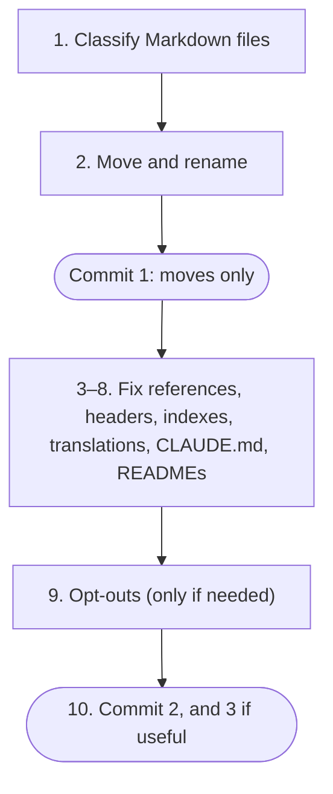

English | [日本語](../ja/ADOPTING.md) · [Docs index](README.md)

# Adopting the shared rules

A checklist for bringing a new or existing project under the shared rules. A Claude Code session in the project can follow it step by step. Discuss each step with the owner in Japanese, and get approval for each commit.

## Before you start

- [ ] The shared rules are active and appear in `/context` ([Setup](SETUP.md)).
- [ ] The working tree is clean, or the owner has said how to handle existing changes.
- [ ] You have read the project's `CLAUDE.md` (if any) and listed every Markdown file in the repository.

## New project

- [ ] Copy [`templates/CLAUDE.md`](../../templates/CLAUDE.md) to the project root and fill in only project-specific rules.
- [ ] Create `docs/en/README.md` and `docs/ja/README.md` from [`templates/docs-index.en.md`](../../templates/docs-index.en.md) and [`templates/docs-index.ja.md`](../../templates/docs-index.ja.md).
- [ ] Write a thin `README.md` and `README.ja.md` ([step 8](#8-thin-readmes)).
- [ ] Add a `.gitignore` that excludes `.env` files and other local secrets.
- [ ] Run the [checks](#checks).

## Existing project

Ten steps, in two or three commits. File moves get a commit of their own, so Git records them as clean renames.



### 1. Classify every Markdown file

Make a table with one row per file: current path, class, new path. Show it to the owner and ask about unclear rows. The classes come from [`rules/documentation.md`](../../rules/documentation.md):

| Class | New location | Translated |
|---|---|---|
| Claude-only (`CLAUDE.md`, `.claude/**`, `prompts/**`, `.ai-eval/**`) | unchanged | no |
| Working doc (ADR log, plans, acceptance logs, research and handoff notes) | `docs/working/` | no |
| Stable doc (spec, architecture, design, data model, algorithms, guides) | `docs/en/` | yes, into `docs/ja/` |
| Directory README next to code | unchanged | no; linked from the indexes |

Data files read by code that live under `docs/` move out too (for example to `data/`). Add them to the table.

### 2. Move and rename (commit 1)

> [!NOTE]
> On case-insensitive file systems (the macOS default), rename in two steps: `git mv docs/spec.md docs/spec.tmp.md`, then `git mv docs/spec.tmp.md docs/en/SPEC.md`.

- [ ] Move each file with `git mv` to its new path. Rename it to `UPPER_SNAKE_CASE.md` if needed.
- [ ] Make no content edits in this commit.
- [ ] Propose the commit, for example `docs: move docs into en and working folders`.

### 3. Fix every reference

- [ ] Search for each old path and file name, and update it everywhere: docs, `CLAUDE.md` "Read first" lists, code comments, CI config, scripts, and package metadata.
- [ ] In docs, replace bare paths in backticks that point to other docs with relative Markdown links.

### 4. Add headers

- [ ] Add the language switcher and back-to-index link to every doc in `docs/en/` ([`templates/doc-header.md`](../../templates/doc-header.md)).

### 5. Write the indexes

- [ ] `docs/en/README.md`: every doc (stable, working, directory READMEs) with a one-line description.
- [ ] `docs/ja/README.md`: the same entries. Mark working docs and other English-only files 「英語のみ」.

### 6. Translate stable docs

- [ ] For each file in `docs/en/`, write `docs/ja/<same name>` with the header, the translation notice, and the `source` line (`git hash-object docs/en/<name>`).
- [ ] Translate the meaning, not the words, following [`rules/writing-style.md`](../../rules/writing-style.md). Keep code, commands, paths, and identifiers unchanged.

### 7. Slim the project `CLAUDE.md`

- [ ] Remove what the shared rules already cover: conversation and repository language, Git and commit conventions, and public-repository safety. Keep anything stricter or project-specific.
- [ ] Keep product UI localization rules (supported locales, translation files, locale handling). They are not shared.
- [ ] Add `## Overrides of shared rules` with one entry per deliberate difference, or `None.` ([Overrides and opt-outs](OVERRIDES.md)).
- [ ] Update "Read first" to the new doc paths.
- [ ] If the project has no `CLAUDE.md`, create one from the template.

### 8. Thin READMEs

- [ ] Cut `README.md` down to a one-paragraph overview, status, a minimal quick start, and links to `README.ja.md` and `docs/en/README.md`. Move longer content into stable docs.
- [ ] Write `README.ja.md` as its translation, linking to `README.md` and `docs/ja/README.md`.

### 9. Opt-outs (only if needed)

- [ ] If a whole shared rule file does not fit the project, add a `claudeMdExcludes` entry ([Overrides and opt-outs](OVERRIDES.md#3-opting-out-of-a-whole-rule-file)) and confirm with `/context`.

### 10. Commit (commit 2, and 3 if useful)

- [ ] Steps 3 to 8 change English docs, so their Japanese twins go in the same commit.
- [ ] A reasonable split: commit 2 for references, headers, indexes, translations, and READMEs; commit 3 for `CLAUDE.md`.
- [ ] Keep the messages of commits made before adoption. Do not rewrite history to match the new conventions.

## Improving readability

After adoption, or for a project that already follows the layout, have a session in the project follow [`prompts/reformat-human-docs.md`](../../prompts/reformat-human-docs.md). It rewrites the human-facing docs to [`rules/writing-style.md`](../../rules/writing-style.md) without changing their facts.

## Checks

Run these from the project root before proposing each commit.

- [ ] Every English doc has a Japanese twin, and vice versa. No output means OK:

  ```bash
  diff <(ls docs/en) <(ls docs/ja)
  ```

- [ ] No Japanese translation is stale. No output means OK:

  ```bash
  for ja in docs/ja/*.md README.ja.md; do read -r src rec <<< "$(sed -n '1s/^<!-- source: \(.*\) blob \([0-9a-f]*\) -->$/\1 \2/p' "$ja")"; [ -n "$rec" ] && [ "$rec" = "$(git hash-object "$src")" ] || echo "stale or missing source line: $ja"; done
  ```

- [ ] Every relative link in Markdown points to an existing file. Check by hand or with a link checker, and record the tool used.
- [ ] `/context` in a new session shows the shared rules and the project's `CLAUDE.md`.
- [ ] Nothing in the commit breaks [`rules/public-repo-safety.md`](../../rules/public-repo-safety.md).
