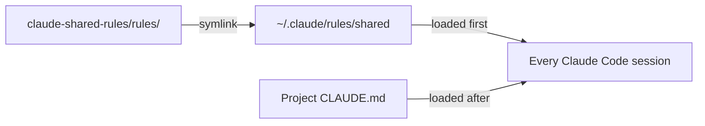

English | [日本語](../ja/SETUP.md) · [Docs index](README.md)

# Setup

One symlink activates the shared rules for every Claude Code session on this machine. This page covers install, verification, updates, and removal.



## Install

You need macOS or Linux with `git` ([Windows](#windows-unverified) is unverified), Claude Code 2.1.281 or later ([why](#version-requirements)), and access to this repository on GitHub.

1. Clone the repository:

   ```bash
   git clone https://github.com/musica-sanare/claude-shared-rules.git ~/repos/claude-shared-rules
   ```

2. Check that nothing exists at the link location. Expect `No such file or directory`:

   ```bash
   ls -la ~/.claude/rules/shared
   ```

3. Create the link:

   ```bash
   mkdir -p ~/.claude/rules
   ```

   ```bash
   ln -s ~/repos/claude-shared-rules/rules ~/.claude/rules/shared
   ```

Personal rules you do not share go directly in `~/.claude/rules/` as separate files.

## Verify

1. Start a **new** session in any project. Running sessions do not load new or changed rules.
2. Run `/context`. Every file in `rules/` must appear under **Memory files**:
   `overrides.md`, `language.md`, `documentation.md`, `writing-style.md`, `git.md`, `public-repo-safety.md`, `github-workflow.md`, `paid-services.md`, `deployment.md`.
3. Optional: ask Claude which shared rule files it loaded. It should answer in Japanese.

If files are missing, run `ls -la ~/.claude/rules/` and check that the link's target exists.

## Update

```bash
git -C ~/repos/claude-shared-rules pull
```

New sessions use the updated rules. Restart running sessions to pick them up.

## Uninstall

Remove the link. Leave off the trailing slash, so only the link goes and the repository stays:

```bash
rm ~/.claude/rules/shared
```

Then remove the [recommended settings](#recommended-settings) and `~/.claude/billing-guard-mcp-allowlist` if you added them. The clone can stay or be deleted separately.

## Recommended settings

Rules guide Claude but enforce nothing. These settings enforce four of them: no AI attribution, a prompt before every push, a check before commands that may incur charges, and a block on deploys and remote changes. Merge them into `~/.claude/settings.json`; do not replace the file.

> [!WARNING]
> Claude Code before 2.1.281 rejects `"attribution": false` and skips the whole settings file. On older versions, use `{ "attribution": { "commit": "", "pr": "", "sessionUrl": false } }` instead.

```json
{
  "attribution": false,
  "permissions": {
    "ask": ["Bash(git push *)"]
  },
  "hooks": {
    "PreToolUse": [
      {
        "matcher": "Bash|mcp__.*",
        "hooks": [
          {
            "type": "command",
            "command": "~/repos/claude-shared-rules/hooks/billing-guard.sh",
            "onFailure": "block"
          }
        ]
      },
      {
        "matcher": "Bash",
        "hooks": [
          {
            "type": "command",
            "command": "~/repos/claude-shared-rules/hooks/deploy-guard.sh",
            "onFailure": "block"
          }
        ]
      }
    ]
  }
}
```

- `"attribution": false` hides the commit trailer and PR attribution Claude Code adds by default.
- `Bash(git push *)` makes Claude Code ask before any command that starts with `git push`, even in auto mode. It misses pushes written another way, such as `git -C . push`, so treat it as a safety net.
- The first `PreToolUse` hook runs the [billing guard](#billing-guard) before every Bash command and MCP tool call, including the browser tools.
- The second runs the [deploy guard](#deploy-guard) before every Bash command.
- `"onFailure": "block"` fails closed: if a script is missing or broken, those calls are blocked instead of running unchecked.
- When both hooks match, the stricter decision wins: the deploy guard's deny beats the billing guard's ask.

### Billing guard

[`hooks/billing-guard.sh`](../../hooks/billing-guard.sh) stops tool calls that may lead to charges until you decide. It enforces [`rules/paid-services.md`](../../rules/paid-services.md) and fails safe: when it is unsure, it stops the call. It is one layer of three; the [account settings](#account-settings) are the layer that cannot be bypassed. It has two parts:

- **Billing pages and tools are always blocked**, in every permission mode. This covers an MCP tool call whose `url` has a billing, plan, upgrade, subscription, payment, checkout, purchase, invoice, API key, credit, spending-limit, or budget path, such as a Cloudflare or Google Cloud billing page in the browser. It also covers a URL set by a browser's JavaScript tool and an MCP tool whose name contains such a word. Only you change plans or billing.
- **Other calls that may lead to charges** are asked about or blocked, depending on the permission mode. These are Bash commands, commands typed into the Terminal panel, MCP servers that are not allowlisted, and scheduled tasks.

What happens on a match depends on the permission mode:

| Permission mode | Result of a match |
|---|---|
| `default`, `plan`, `acceptEdits` | Claude Code asks you to approve or reject the call. |
| `auto`, `bypassPermissions`, `dontAsk` | The call is blocked. Claude must tell you what it wanted to run. |

> [!WARNING]
> In auto mode, a hook's "ask" is resolved without showing you a prompt (observed on 2026-10-31). That is why the guard blocks instead. To run a blocked command, type it yourself with a `!` prefix in the prompt box, or switch to default mode.

#### Commands it stops

A command matches when it:

- installs or runs a package for a paid AI or cloud service, such as `pip install anthropic`, `npm i @anthropic-ai/sdk`, or `uvx llm`. A plain install (`uv sync`, `npm install`, `pip install -r requirements.txt`) matches when the project's manifest or lock file lists such a package;
- runs code that imports a paid SDK, reads a paid service's API key, or contains a paid API endpoint. This covers code given with `python -c`, `node -e`, or a heredoc, script files such as `python3 app.py` or `./run.sh`, and package scripts such as `npm run seed`;
- runs code the guard cannot read: a script that does not exist yet, or shell or Python code piped in from standard input;
- calls a paid API endpoint with `curl`, `wget`, or a similar client, such as `api.anthropic.com` or `api.openai.com`;
- runs a cloud or hosting CLI (`aws`, `gcloud`, `az`, `firebase`, `vercel`, `wrangler`, `supabase`, `stripe`, `modal`, and others) or an AI CLI (`aider`, `llm`, and others), also through `npx` and similar runners, except a bare `--version` or `--help`. Wrangler commands that stay local pass without a prompt: `wrangler dev`, `types`, `docs`, and any command with `--dry-run` or `--local`, unless the command also has `--remote`;
- applies infrastructure (`terraform apply`, `pulumi up`, `cdk deploy`, and others);
- schedules jobs or starts CI: `crontab`, `launchctl load`, `at`, `gh workflow run`, `gh codespace create`.

While credentials for a paid service are available, **any command that runs code** matches, such as `python3`, `node`, `npm test`, `make`, or an unknown program. Text-only commands such as `git`, `grep`, `cat`, and `ls` still pass. The guard looks for credentials in these places and reports only their names:

- environment variables named like an API key or secret (`*_API_KEY`, `*_API_TOKEN`, `*_SECRET_KEY`, `*_AUTH_TOKEN`, `AWS_PROFILE`, `GOOGLE_APPLICATION_CREDENTIALS`, and others), in the environment, in a shell profile (`~/.zshrc` and others), in the command itself, or in a `.env` or `.dev.vars` file in the working directory;
- cloud CLI logins: `~/.aws/credentials`, Google Cloud application default credentials, the Azure CLI token cache, the Wrangler login, and `llm` keys.

The guard splits a command into simple commands with [`hooks/lib/shell-lex.awk`](../../hooks/lib/shell-lex.awk), the lexer it shares with the [deploy guard](#deploy-guard). Quoted arguments of text-only commands and heredocs written to `cat` or `git` do not match, so a commit message that mentions `pip install openai` passes. Code passed to an interpreter is checked as code.

#### MCP servers it asks about

Only these MCP servers run without asking: the Claude apps' own servers (the built-in browser, Claude in Chrome, `ccd_*`, `visualize`, `terminal`, `scheduled-tasks`, the iOS Simulator, `mcp-registry`, `remote-devices`) and the servers you list in `~/.claude/billing-guard-mcp-allowlist`, one server name per line. The server name is the part between `mcp__` and the next `__` in a tool name. Commands typed into the Terminal panel get the same checks as Bash commands. Creating, updating, or running a scheduled task is asked about.

To trust another server, such as a docs connector:

```bash
echo 'server-name' >> ~/.claude/billing-guard-mcp-allowlist
```

#### What it cannot see

- Code reached indirectly, such as a module that a checked script imports, or a script path held in a variable inside another script.
- Write and Edit tool calls, so a CI workflow or cron file written with them is not checked. Running or pushing it is: `git push` asks through `Bash(git push *)`.
- Browser clicks that reach a billing page without a navigation call, such as a link inside a dashboard. The rule still forbids this.
- Cloud sessions, routines, and Cowork, where local hooks do not run.
- Paid services that need no credentials on this machine, such as Claude extra usage. Only the [account settings](#account-settings) cover these.

#### False positives and what to do

A false positive is possible. For example, a shell script that only rewrites docs can still match if it contains a paid SDK import as text. Then:

- To write or edit files, use the Edit or Write tool instead of a shell command. The guard does not check those tools.
- Otherwise run the command yourself with a `!` prefix in the prompt box, or switch to default mode and approve it.

It needs `bash`. Without `jq` it cannot read the permission mode, so every match is blocked. To change what it catches, edit the patterns near the top of the script and add a case to the tests.

### Deploy guard

[`hooks/deploy-guard.sh`](../../hooks/deploy-guard.sh) blocks deploys and remote changes in every permission mode, including auto and bypass. It enforces [`rules/deployment.md`](../../rules/deployment.md), which lists the covered commands. Claude never runs them, so there is nothing to ask.

It blocks a Bash command that:

- deploys, uploads, promotes, or rolls back a version, such as `wrangler deploy`, `vercel --prod`, or `firebase deploy`, except with `--dry-run` where the CLI has one;
- changes remote resources or secrets, such as any `wrangler` command with `--remote`, `wrangler secret put`, `supabase db push`, `terraform apply`, or `kubectl apply`;
- logs a cloud CLI in or out, such as `wrangler login` or `gcloud auth login`;
- publishes a package or image, such as `npm publish` or `docker push`;
- runs a package script that does any of the above. For `npm run`, `pnpm`, `yarn`, and `bun`, the guard reads the script from `package.json` in the working directory (after `cd` or `--prefix`), and follows scripts that call other scripts;
- runs a package script, Make target, or script file whose name contains `deploy`, `publish`, `release`, or `rollback`, whatever it contains.

It splits a command with the shared lexer [`hooks/lib/shell-lex.awk`](../../hooks/lib/shell-lex.awk) at `;`, `&&`, `|`, and command substitutions, and looks through `npx`, `pnpm exec`, `sudo`, `env`, `bash -c`, and `eval`. Quoted arguments and heredoc bodies, such as a commit message that mentions `wrangler deploy`, do not match.

Local and read-only commands pass: `wrangler dev`, `wrangler deploy --dry-run`, `wrangler types`, `wrangler d1 execute --local`, `terraform plan`, and any command with only `--help` or `--version`.

A false positive is possible, such as a script named `release-notes`. Run it yourself with a `!` prefix in the prompt box. It cannot see:

- code that deploys when run, such as `node build.js` calling a cloud API without a deploy-like name;
- Git pushes that trigger a deploy through the hosting provider. The push prompt from `Bash(git push *)` covers those.

It needs `bash`. Without `jq` it cannot read `package.json`, so scripts are checked by name only. To change what it catches, edit the `rule` lines in `check_rules`. Run the tests after any change to either guard:

```bash
bash ~/repos/claude-shared-rules/hooks/tests/run.sh
```

### Account settings

Set every paid account so that it cannot charge more than you allow. This is the layer Claude cannot bypass: the rule and the hooks can miss a path, but an account without a way to pay cannot bill. Do these yourself; Claude never opens billing pages.

1. **Claude extra usage**: in claude.ai, open **Settings → Usage** and turn extra usage off, or set a monthly limit. Never choose unlimited. Turning it off also turns off fast mode in Claude Code.
2. **Claude Code sign-in**: sign in with your Pro or Max account, not with a Console (API) account or an `ANTHROPIC_API_KEY`. An API key bills per use.
3. **Paid APIs** (Anthropic Console, OpenAI, and others): prefer prepaid credits with auto-reload turned off, and set a hard monthly limit where the service offers one.
4. **Cloud accounts**: remove payment methods from accounts that do not need one, and stay on free plans that stop at their limits. Where a payment method is needed, set spending limits. A budget that only sends alerts does not stop charges.
5. **Review** these settings when you add a service, and list every account that has a payment method.

### Credentials without billing access

Give Claude only credentials that cannot change billing. Even when a service can bill, a credential without billing permission cannot change a plan by any path.

- **Tokens and keys**: create them with the minimum permissions the task needs. Leave out billing, plan, payment, and account-admin permissions. For example, a Cloudflare API token without the Billing permission, or a Google Cloud service account without billing roles.
- **Browser sign-ins**: do not sign in to an account that can change billing in a browser Claude controls (the built-in browser or Claude in Chrome). If Claude needs a dashboard, use a member account without billing access.
- **Local CLI logins and API keys**: a CLI that you logged in to as an account owner (for example `wrangler login` or `gcloud auth login`) acts with your full rights when Claude runs it. Log out after use. Keep API keys out of your shell profile and out of `.env` files in projects Claude works on; pass a scoped key only for the task that needs it. While any such credential is available, the [billing guard](#billing-guard) asks before every command that runs code.

Claude asks for credentials this way too: it names the minimum permissions and excludes billing ([`rules/paid-services.md`](../../rules/paid-services.md)).

## Optional rules

Some rules suit only some people, so they live in `optional/` and do not load by default. Link the ones you want into `~/.claude/rules/`.

| File | Effect |
|---|---|
| [`conversation-kansai.md`](../../optional/conversation-kansai.md) | Claude talks to you in friendly Kansai dialect. Docs, commits, and other repository text are unaffected. |

To opt in, link the file, then start a new session and check `/context`:

```bash
ln -s ~/repos/claude-shared-rules/optional/conversation-kansai.md ~/.claude/rules/conversation-kansai.md
```

To opt out, remove the link:

```bash
rm ~/.claude/rules/conversation-kansai.md
```

### On a machine without the shared rules

An optional rule also works alone, for example on a work machine whose projects follow an organization's rules. Copy the file into your own `~/.claude/rules/`:

```bash
mkdir -p ~/.claude/rules
```

```bash
curl -fsSL -o ~/.claude/rules/conversation-kansai.md https://raw.githubusercontent.com/musica-sanare/claude-shared-rules/main/optional/conversation-kansai.md
```

- `~/.claude/rules/` belongs to your user account on that machine. Nothing goes into the organization's settings or any repository.
- The file states its own precedence: organization, project, and skill rules on tone and on the wording of commits, PRs, docs, and messages win over it. Only your conversation with Claude changes.
- To stop, delete the file. Updates are not automatic; copy it again to get a newer version.

> [!NOTE]
> Check your organization's policy on personal Claude Code settings before adding the file. This setup has not been tried on a work machine yet.

## New machine

1. Install Git and Claude Code, and sign in to GitHub.
2. Follow [Install](#install).
3. Add the [recommended settings](#recommended-settings) and [optional rules](#optional-rules) if wanted.
4. Clone the project repositories and [verify](#verify) in one of them.

## Windows (unverified)

> [!WARNING]
> Nothing in this section has been tested on Windows. Check each point and record the result here before relying on it.

WSL works like Linux: follow the main instructions inside WSL. For native Windows, the design is the same; only the link and the shell differ.

- **Link**: use a directory junction instead of a symlink. Junctions need neither administrator rights nor Developer Mode. In PowerShell:

  ```powershell
  git clone https://github.com/musica-sanare/claude-shared-rules.git $HOME\repos\claude-shared-rules
  ```

  ```powershell
  Test-Path $HOME\.claude\rules\shared
  ```

  Expect `False`. Then:

  ```powershell
  New-Item -ItemType Directory -Force $HOME\.claude\rules
  ```

  ```powershell
  New-Item -ItemType Junction -Path $HOME\.claude\rules\shared -Target $HOME\repos\claude-shared-rules\rules
  ```

- **Uninstall**: `rmdir` removes only the junction, not the files it points to:

  ```powershell
  cmd /c rmdir "$HOME\.claude\rules\shared"
  ```

- **Optional rules** are single files, and a junction works only for directories. Use a file symlink (needs Developer Mode or administrator rights) or copy the file.
- **Check scripts** in [Adopting the shared rules](ADOPTING.md#checks) need bash. Run them in Git Bash or WSL.
- **Billing guard and deploy guard** are bash scripts. Claude Code runs hooks with Git Bash when it is installed; without it, the hooks fail and block Bash commands.

Open questions (`要確認`):

- Does Claude Code follow a junction under `~/.claude/rules/` and load the rules? Check with `/context`.
- Do `claudeMdExcludes` patterns such as `**/claude-shared-rules/rules/documentation.md` match Windows paths (backslashes, drive letters)?

## Known limitations

- **Cloud sessions** (Claude Code on the web and other remote sessions) cannot see `~/.claude/` on this Mac. Put rules that must apply there in the project's own `CLAUDE.md`.
- **Cowork sessions** skip symlinked rules that point outside the session's working directory, so the shared rules do not load. CLI and desktop Code tab sessions are unaffected.
- **Conflicts** between a user rule and a project rule are not resolved by Claude Code itself. The precedence in [Overrides and opt-outs](OVERRIDES.md) works only because the rules state it.
- **Windows** instructions are unverified. See [Windows (unverified)](#windows-unverified).

## Background

### How loading works

Claude Code loads every `.md` file under `~/.claude/rules/` in every project, before the project's own instructions. It searches recursively and follows symlinks. User-scope rules need no approval dialog.

### Version requirements

| Version | Needed for |
|---|---|
| 2.1.281 or later | `"attribution": false` in [recommended settings](#recommended-settings) |
| 2.1.239 or later | `claudeMdExcludes` matching a symlinked rule by its link path |

### Sources

Checked against the official Claude Code docs on 2026-10-25: [Memory](https://code.claude.com/docs/en/memory), [Settings reference](https://code.claude.com/docs/en/settings-reference), [Permissions](https://code.claude.com/docs/en/permissions). Re-check them when something does not work as described.
