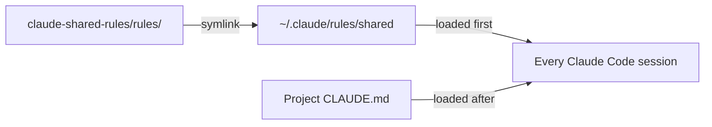

English | [日本語](../ja/SETUP.md) · [Docs index](README.md)

# Setup

One symlink activates the shared rules for every Claude Code session on this machine. This page covers install, verification, updates, and removal.



## Install

You need macOS or Linux with `git` ([Windows](#windows-unverified) is unverified), Claude Code 2.1.281 or later ([why](#version-requirements)), and access to this repository on GitHub.

1. Clone the repository:

   ```bash
   git clone https://github.com/musica-sanare/claude-shared-rules.git ~/repos/claude-shared-rules
   ```

2. Check that nothing exists at the link location. Expect `No such file or directory`:

   ```bash
   ls -la ~/.claude/rules/shared
   ```

3. Create the link:

   ```bash
   mkdir -p ~/.claude/rules
   ```

   ```bash
   ln -s ~/repos/claude-shared-rules/rules ~/.claude/rules/shared
   ```

Personal rules you do not share go directly in `~/.claude/rules/` as separate files.

## Verify

1. Start a **new** session in any project. Running sessions do not load new or changed rules.
2. Run `/context`. Every file in `rules/` must appear under **Memory files**:
   `overrides.md`, `language.md`, `documentation.md`, `writing-style.md`, `git.md`, `public-repo-safety.md`, `github-workflow.md`.
3. Optional: ask Claude which shared rule files it loaded. It should answer in Japanese.

If files are missing, run `ls -la ~/.claude/rules/` and check that the link's target exists.

## Update

```bash
git -C ~/repos/claude-shared-rules pull
```

New sessions use the updated rules. Restart running sessions to pick them up.

## Uninstall

Remove the link. Leave off the trailing slash, so only the link goes and the repository stays:

```bash
rm ~/.claude/rules/shared
```

Then remove the [recommended settings](#recommended-settings) if you added them. The clone can stay or be deleted separately.

## Recommended settings

Rules guide Claude but enforce nothing. These settings enforce two of them: no AI attribution, and a prompt before every push. Merge them into `~/.claude/settings.json`; do not replace the file.

> [!WARNING]
> Claude Code before 2.1.281 rejects `"attribution": false` and skips the whole settings file. On older versions, use `{ "attribution": { "commit": "", "pr": "", "sessionUrl": false } }` instead.

```json
{
  "attribution": false,
  "permissions": {
    "ask": ["Bash(git push *)"]
  }
}
```

- `"attribution": false` hides the commit trailer and PR attribution Claude Code adds by default.
- `Bash(git push *)` makes Claude Code ask before any command that starts with `git push`, even in auto mode. It misses pushes written another way, such as `git -C . push`, so treat it as a safety net.

## Optional rules

Some rules suit only some people, so they live in `optional/` and do not load by default. Link the ones you want into `~/.claude/rules/`.

| File | Effect |
|---|---|
| [`conversation-kansai.md`](../../optional/conversation-kansai.md) | Claude talks to you in friendly Kansai dialect. Docs, commits, and other repository text are unaffected. |

To opt in, link the file, then start a new session and check `/context`:

```bash
ln -s ~/repos/claude-shared-rules/optional/conversation-kansai.md ~/.claude/rules/conversation-kansai.md
```

To opt out, remove the link:

```bash
rm ~/.claude/rules/conversation-kansai.md
```

## New machine

1. Install Git and Claude Code, and sign in to GitHub.
2. Follow [Install](#install).
3. Add the [recommended settings](#recommended-settings) and [optional rules](#optional-rules) if wanted.
4. Clone the project repositories and [verify](#verify) in one of them.

## Windows (unverified)

> [!WARNING]
> Nothing in this section has been tested on Windows. Check each point and record the result here before relying on it.

WSL works like Linux: follow the main instructions inside WSL. For native Windows, the design is the same; only the link and the shell differ.

- **Link**: use a directory junction instead of a symlink. Junctions need neither administrator rights nor Developer Mode. In PowerShell:

  ```powershell
  git clone https://github.com/musica-sanare/claude-shared-rules.git $HOME\repos\claude-shared-rules
  ```

  ```powershell
  Test-Path $HOME\.claude\rules\shared
  ```

  Expect `False`. Then:

  ```powershell
  New-Item -ItemType Directory -Force $HOME\.claude\rules
  ```

  ```powershell
  New-Item -ItemType Junction -Path $HOME\.claude\rules\shared -Target $HOME\repos\claude-shared-rules\rules
  ```

- **Uninstall**: `rmdir` removes only the junction, not the files it points to:

  ```powershell
  cmd /c rmdir "$HOME\.claude\rules\shared"
  ```

- **Optional rules** are single files, and a junction works only for directories. Use a file symlink (needs Developer Mode or administrator rights) or copy the file.
- **Check scripts** in [Adopting the shared rules](ADOPTING.md#checks) need bash. Run them in Git Bash or WSL.

Open questions (`要確認`):

- Does Claude Code follow a junction under `~/.claude/rules/` and load the rules? Check with `/context`.
- Do `claudeMdExcludes` patterns such as `**/claude-shared-rules/rules/documentation.md` match Windows paths (backslashes, drive letters)?

## Known limitations

- **Cloud sessions** (Claude Code on the web and other remote sessions) cannot see `~/.claude/` on this Mac. Put rules that must apply there in the project's own `CLAUDE.md`.
- **Cowork sessions** skip symlinked rules that point outside the session's working directory, so the shared rules do not load. CLI and desktop Code tab sessions are unaffected.
- **Conflicts** between a user rule and a project rule are not resolved by Claude Code itself. The precedence in [Overrides and opt-outs](OVERRIDES.md) works only because the rules state it.
- **Windows** instructions are unverified. See [Windows (unverified)](#windows-unverified).

## Background

### How loading works

Claude Code loads every `.md` file under `~/.claude/rules/` in every project, before the project's own instructions. It searches recursively and follows symlinks. User-scope rules need no approval dialog.

### Version requirements

| Version | Needed for |
|---|---|
| 2.1.281 or later | `"attribution": false` in [recommended settings](#recommended-settings) |
| 2.1.239 or later | `claudeMdExcludes` matching a symlinked rule by its link path |

### Sources

Checked against the official Claude Code docs on 2026-10-25: [Memory](https://code.claude.com/docs/en/memory), [Settings reference](https://code.claude.com/docs/en/settings-reference), [Permissions](https://code.claude.com/docs/en/permissions). Re-check them when something does not work as described.
