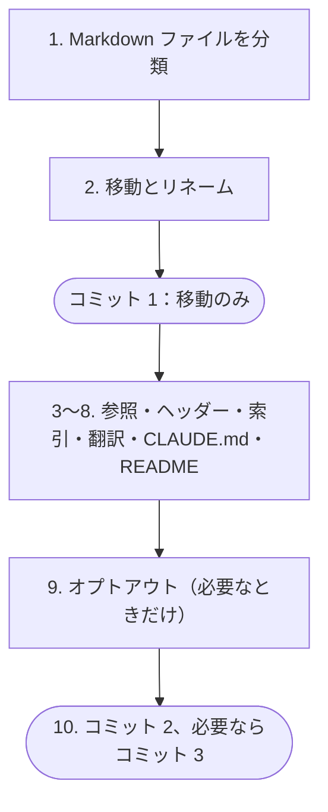

<!-- source: docs/en/ADOPTING.md blob 003383f335545d0d499dc7e86c34cfc4523e639e -->
[English](../en/ADOPTING.md) | 日本語 · [目次に戻る](README.md)

> この文書は[英語版](../en/ADOPTING.md)の翻訳。内容が異なる場合は英語版が優先する。

# 共有ルールの導入

新規・既存のプロジェクトに共有ルールを導入するためのチェックリスト。プロジェクトの Claude Code セッションが、このまま上から順に実行できる。各手順はオーナーと日本語で相談し、コミットは 1 件ずつ承認をもらう。

## 始める前に

- [ ] 共有ルールが有効で、`/context` に出ている（[セットアップ](SETUP.md)）。
- [ ] 作業ツリーがクリーン。そうでなければ、既存の変更の扱いをオーナーに決めてもらってある。
- [ ] プロジェクトの `CLAUDE.md` があれば読み、リポジトリ内の Markdown ファイルをすべて洗い出してある。

## 新規プロジェクト

- [ ] [`templates/CLAUDE.md`](../../templates/CLAUDE.md) をプロジェクトのルートにコピーし、プロジェクト固有のルールだけを書く。
- [ ] [`templates/docs-index.en.md`](../../templates/docs-index.en.md) と [`templates/docs-index.ja.md`](../../templates/docs-index.ja.md) から `docs/en/README.md` と `docs/ja/README.md` を作る。
- [ ] 薄い `README.md` と `README.ja.md` を書く（[手順 8](#8-readme-を薄くする)）。
- [ ] `.env` などローカルの秘密情報を除外する `.gitignore` を置く。
- [ ] [チェック](#チェック)を実行する。

## 既存プロジェクト

手順は 10 個で、コミットは 2〜3 回に分ける。ファイルの移動だけは単独のコミットにする。こうすると Git が素直なリネームとして記録する。



### 1. Markdown ファイルをすべて分類する

1 ファイル 1 行で、現在のパス・分類・新しいパスの表を作る。表はオーナーに見せ、迷う行は相談する。分類は [`rules/documentation.md`](../../rules/documentation.md) に従う：

| 分類 | 新しい場所 | 翻訳 |
|---|---|---|
| Claude 専用（`CLAUDE.md`、`.claude/**`、`prompts/**`、`.ai-eval/**`） | そのまま | しない |
| 作業用ドキュメント（ADR の記録、計画、受け入れ記録、調査メモ、引き継ぎメモ） | `docs/working/` | しない |
| 安定ドキュメント（仕様、アーキテクチャ、設計、データモデル、アルゴリズム、各種ガイド） | `docs/en/` | する（`docs/ja/` へ） |
| コードの横にあるディレクトリの README | そのまま | しない（索引からリンク） |

`docs/` の下にある、コードが読むデータファイルも外へ出す（例：`data/`）。これも表に入れる。

### 2. 移動とリネーム（コミット 1）

> [!NOTE]
> 大文字と小文字を区別しないファイルシステム（macOS の既定）では、リネームを 2 段階に分ける：`git mv docs/spec.md docs/spec.tmp.md` のあと `git mv docs/spec.tmp.md docs/en/SPEC.md`。

- [ ] 各ファイルを `git mv` で新しいパスへ移す。必要なら名前を `UPPER_SNAKE_CASE.md` にする。
- [ ] このコミットでは中身を一切変えない。
- [ ] コミットを提案する。例：`docs: move docs into en and working folders`。

### 3. 参照をすべて直す

- [ ] 古いパスとファイル名を検索し、見つかった箇所をすべて直す。対象はドキュメント、`CLAUDE.md` の「Read first」、コードのコメント、CI の設定、スクリプト、パッケージのメタデータ。
- [ ] ドキュメント内で、他の文書をバッククォートのパスで示している箇所は、相対パスの Markdown リンクに置き換える。

### 4. ヘッダーを付ける

- [ ] `docs/en/` のすべての文書に、言語切り替えと目次へのリンクを付ける（[`templates/doc-header.md`](../../templates/doc-header.md)）。

### 5. 索引を書く

- [ ] `docs/en/README.md`：すべての文書（安定ドキュメント、作業用ドキュメント、ディレクトリの README）を 1 行の説明付きで載せる。
- [ ] `docs/ja/README.md`：同じ項目を載せる。作業用ドキュメントなど英語しかないものには「英語のみ」と付ける。

### 6. 安定ドキュメントを翻訳する

- [ ] `docs/en/` の各ファイルについて `docs/ja/<同じ名前>` を作り、ヘッダー、翻訳の注記、`source` 行（`git hash-object docs/en/<name>` の値）を入れる。
- [ ] 語ではなく意味を訳す。書き方は [`rules/writing-style.md`](../../rules/writing-style.md) に従う。コード、コマンド、パス、識別子は変えない。

### 7. プロジェクトの `CLAUDE.md` を絞る

- [ ] 共有ルールと重なる部分を消す：会話とリポジトリの言語、Git とコミットの規約、公開リポジトリの安全性。共有ルールより厳しいものとプロジェクト固有のものは残す。
- [ ] プロダクト UI のローカライズのルール（対応ロケール、翻訳ファイル、ロケールの扱い）は残す。これは共有しない。
- [ ] `## Overrides of shared rules` を作り、意図して変えている点を 1 件ずつ書く。なければ `None.` と書く（[上書きとオプトアウト](OVERRIDES.md)）。
- [ ] 「Read first」を新しいパスに合わせる。
- [ ] `CLAUDE.md` がなければテンプレートから作る。

### 8. README を薄くする

- [ ] `README.md` を、1 段落の概要、状態、最小限のクイックスタート、`README.ja.md` と `docs/en/README.md` へのリンクだけにする。長い内容は安定ドキュメントへ移す。
- [ ] `README.ja.md` をその翻訳として書き、`README.md` と `docs/ja/README.md` へリンクする。

### 9. オプトアウト（必要なときだけ）

- [ ] 共有ルールのファイルが丸ごとプロジェクトに合わないときは、`claudeMdExcludes` に追加し（[上書きとオプトアウト](OVERRIDES.md#3-ルールファイルを丸ごと外す)）、`/context` で確かめる。

### 10. コミットする（コミット 2、必要ならコミット 3）

- [ ] 手順 3〜8 は英語の文書を変えるので、日本語版も同じコミットに入れる。
- [ ] 分け方の目安：参照・ヘッダー・索引・翻訳・README をコミット 2 に、`CLAUDE.md` をコミット 3 にする。
- [ ] 導入前のコミットのメッセージはそのまま残す。新しい規約に合わせて履歴を書き換えたりしない。

## 読みやすさの改善

導入が済んだら、あるいは最初からこの構成のプロジェクトなら、そのプロジェクトのセッションに [`prompts/reformat-human-docs.md`](../../prompts/reformat-human-docs.md) を実行させる。人向けの文書を、事実は変えずに [`rules/writing-style.md`](../../rules/writing-style.md) に沿って書き直してくれる。

## チェック

コミットを提案する前に、毎回プロジェクトのルートで実行する。

- [ ] 英語の文書と日本語の文書が 1 対 1 で揃っている。何も出なければ問題なし：

  ```bash
  diff <(ls docs/en) <(ls docs/ja)
  ```

- [ ] 古くなった日本語訳がない。何も出なければ問題なし：

  ```bash
  for ja in docs/ja/*.md README.ja.md; do read -r src rec <<< "$(sed -n '1s/^<!-- source: \(.*\) blob \([0-9a-f]*\) -->$/\1 \2/p' "$ja")"; [ -n "$rec" ] && [ "$rec" = "$(git hash-object "$src")" ] || echo "stale or missing source line: $ja"; done
  ```

- [ ] Markdown の相対リンクがすべて実在するファイルを指している。手作業かリンクチェッカーで確かめ、使ったツールを記録する。
- [ ] 新しいセッションの `/context` に、共有ルールとプロジェクトの `CLAUDE.md` が出ている。
- [ ] コミットの中身が [`rules/public-repo-safety.md`](../../rules/public-repo-safety.md) に反していない。
