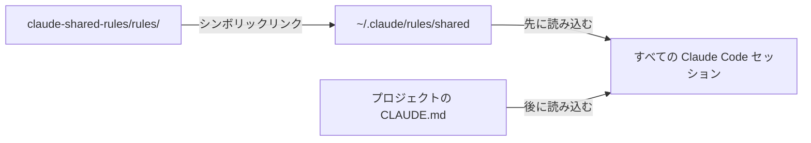

<!-- source: docs/en/SETUP.md blob 2b0783eaa687fdcfd1fe9542c85e5c1bfd967b26 -->
[English](../en/SETUP.md) | 日本語 · [目次に戻る](README.md)

> この文書は[英語版](../en/SETUP.md)の翻訳。内容が異なる場合は英語版が優先する。

# セットアップ

シンボリックリンクを 1 本張るだけで、このマシンのすべての Claude Code セッションで共有ルールが有効になる。この文書ではインストール、確認、更新、削除の手順を説明する。



## インストール

必要なもの：`git` が使える macOS か Linux（[Windows](#windows未検証) は未検証）、Claude Code 2.1.281 以上（[理由](#バージョン要件)）、GitHub 上のこのリポジトリへのアクセス権。

1. リポジトリをクローンする：

   ```bash
   git clone https://github.com/musica-sanare/claude-shared-rules.git ~/repos/claude-shared-rules
   ```

2. リンクを作る場所に何もないことを確かめる。`No such file or directory` と出れば正常：

   ```bash
   ls -la ~/.claude/rules/shared
   ```

3. リンクを作る：

   ```bash
   mkdir -p ~/.claude/rules
   ```

   ```bash
   ln -s ~/repos/claude-shared-rules/rules ~/.claude/rules/shared
   ```

共有しない個人用ルールは、`~/.claude/rules/` に別ファイルとして直接置けばよい。

## 確認

1. 任意のプロジェクトで**新しい**セッションを開く。実行中のセッションは、追加・変更したルールを読み込まない。
2. `/context` を実行する。**Memory files** に `rules/` の全ファイルが出ていれば成功：
   `overrides.md`、`language.md`、`documentation.md`、`writing-style.md`、`git.md`、`public-repo-safety.md`、`github-workflow.md`、`paid-services.md`、`deployment.md`。
3. 任意：読み込んだ共有ルールを Claude に尋ねる。日本語で答えれば正常。

ファイルが出ない場合は、`ls -la ~/.claude/rules/` でリンクとリンク先を確かめる。

## 更新

```bash
git -C ~/repos/claude-shared-rules pull
```

新しいセッションから更新後のルールが効く。実行中のセッションは再起動すれば反映される。

## アンインストール

リンクを削除する。末尾にスラッシュを付けなければ、リンクだけが消えてリポジトリは残る：

```bash
rm ~/.claude/rules/shared
```

[推奨設定](#推奨設定)を入れていた場合は、それも外す。クローンは残しても消してもよい。

## 推奨設定

ルールは Claude への指針で、強制力はない。次の設定で 3 つのルールを強制できる：AI 帰属表示を付けないこと、push の前に必ず確認すること、課金につながりうるコマンドの前に確認すること。`~/.claude/settings.json` に統合し、ファイルごと置き換えないこと。

> [!WARNING]
> 2.1.281 より前の Claude Code は `"attribution": false` を受け付けず、設定ファイル全体を読み飛ばす。古いバージョンでは代わりに `{ "attribution": { "commit": "", "pr": "", "sessionUrl": false } }` を使う。

```json
{
  "attribution": false,
  "permissions": {
    "ask": ["Bash(git push *)"]
  },
  "hooks": {
    "PreToolUse": [
      {
        "matcher": "Bash|mcp__.*",
        "hooks": [
          {
            "type": "command",
            "command": "~/repos/claude-shared-rules/hooks/billing-guard.sh",
            "onFailure": "block"
          }
        ]
      }
    ]
  }
}
```

- `"attribution": false`：Claude Code が既定で付けるコミットのトレーラーと PR の帰属表示を消す。
- `Bash(git push *)`：`git push` で始まるコマンドの前に、auto モードでも確認が入る。`git -C . push` のような別の書き方は拾えないので、あくまで安全網と考える。
- `PreToolUse` フック：Bash コマンドと、ブラウザを含む MCP ツールの呼び出しの前に、毎回[課金ガード](#課金ガード)を走らせる。`"onFailure": "block"` で安全側に倒す。スクリプトが無い・壊れているときは、チェックなしで通すのではなくその呼び出しを止める。

### 課金ガード

[`hooks/billing-guard.sh`](../../hooks/billing-guard.sh) は、課金につながりうるツール呼び出しを、オーナーが判断するまで止める。[`rules/paid-services.md`](../../rules/paid-services.md) を強制するためのものだ。2 つの部分からなる：

- **請求やプランのページ・ツールは、どの権限モードでも常に止める。** 対象は、MCP ツールが開く `url` に請求、プラン、アップグレード、サブスクリプション、支払い、チェックアウト、購入、請求書のパスがある呼び出しだ。ブラウザで開く Cloudflare や Google Cloud の請求ページなどがこれにあたる。ツール名にそうした語を含む MCP ツールも止める。プランや請求を変えるのはオーナーだけだ。
- **課金につながりうる Bash コマンド**は、権限モードに応じて確認するか止める。

Bash コマンドで引っかかったときの動きは、権限モードで変わる：

| 権限モード | 引っかかったときの動き |
|---|---|
| `default`、`plan`、`acceptEdits` | Claude Code が承認か拒否かを尋ねる |
| `auto`、`bypassPermissions`、`dontAsk` | コマンドを止める。Claude は何を実行しようとしたかをオーナーに伝える |

> [!WARNING]
> auto モードでは、フックの「ask」は確認ダイアログを出さずに判定される（2026-10-31 に確認）。そのためガードは止める側に倒している。止められたコマンドを実行するには、入力欄で先頭に `!` を付けて自分で打つか、default モードに切り替える。

次のコマンドが対象になる：

- 有料の AI やクラウドサービスのパッケージを入れる・実行する（`pip install anthropic`、`npm i @anthropic-ai/sdk` など）
- 有料 API やクラウド API のエンドポイントを含む（`api.anthropic.com`、`api.openai.com`、`api.cloudflare.com` など）
- クラウドやホスティングの CLI を実行する（`aws`、`gcloud`、`az`、`firebase`、`vercel`、`wrangler` など。`npx` などの経由も含む）。`--version` や `--help` だけのものは除く
- インフラを適用する（`terraform apply`、`pulumi up`、`cdk deploy` など）

次のものは検出できない：

- 実行すると有料 API を呼ぶコード（環境変数に API キーがある状態での `python app.py` など）
- 引数なしの `npm install` や `pip install -r requirements.txt` で入るパッケージ
- スクリプト名の陰にあるコマンド（`npm run deploy` など）
- 画面遷移の呼び出しを使わずに請求ページへ行くブラウザのクリック（ダッシュボード内のリンク経由など）。ルールでは引き続き禁止している

`bash` が必要だ。`jq` が無いと権限モードを読めないため、引っかかったものはすべて止める。誤検出もありうる（`pip install openai` に触れたコミットメッセージなど）。検出対象を変えるときは、スクリプト冒頭のパターンを編集する。

### 請求の権限を持たない認証情報

Claude には、請求を変更できない認証情報だけを渡す。これが最終防衛線になる。ルールやフックは経路を見落とすことがあるが、請求の権限が無い認証情報なら、どの経路からでもプランは変えられない。

- **トークンとキー**：作業に必要な最小限の権限で作る。請求、プラン、支払い、アカウント管理の権限は外す。たとえば Billing 権限を付けない Cloudflare の API トークンや、請求関連のロールを持たない Google Cloud のサービスアカウントだ。
- **ブラウザのログイン**：Claude が操作するブラウザ（内蔵ブラウザや Claude in Chrome）では、請求を変更できるアカウントにログインしない。Claude がダッシュボードを使う必要があるなら、請求の権限を持たないメンバーのアカウントを使う。
- **手元の CLI のログイン**：アカウントのオーナーとしてログインした CLI（`wrangler login` や `gcloud auth login` など）は、Claude が実行するとオーナーの全権限で動く。Claude が作業するプロジェクトでは、権限を絞ったトークンを環境変数で渡す方を選ぶ。

Claude も認証情報を求めるときはこのやり方に従う。必要最小限の権限を示し、請求の権限は外すよう伝える（[`rules/paid-services.md`](../../rules/paid-services.md)）。

## オプションのルール

人によって好みが分かれるルールは `optional/` に置いてあり、既定では読み込まない。使いたいものだけ `~/.claude/rules/` にリンクする。

| ファイル | 効果 |
|---|---|
| [`conversation-kansai.md`](../../optional/conversation-kansai.md) | Claude との会話が親しみやすい関西弁になる。ドキュメントやコミットなど、リポジトリに残る文章は変わらない |

使うときはリンクを張り、新しいセッションを開いて `/context` で確かめる：

```bash
ln -s ~/repos/claude-shared-rules/optional/conversation-kansai.md ~/.claude/rules/conversation-kansai.md
```

やめるときはリンクを消す：

```bash
rm ~/.claude/rules/conversation-kansai.md
```

### 共有ルールを入れていないマシンで使う

オプションのルールは単独でも使える。例えば、組織のルールに従うプロジェクトしかない職場のマシンでもよい。自分の `~/.claude/rules/` にファイルをコピーする：

```bash
mkdir -p ~/.claude/rules
```

```bash
curl -fsSL -o ~/.claude/rules/conversation-kansai.md https://raw.githubusercontent.com/musica-sanare/claude-shared-rules/main/optional/conversation-kansai.md
```

- `~/.claude/rules/` はそのマシンの自分のユーザーアカウントだけの設定だ。組織の設定にもリポジトリにも何も入らない。
- 優先順位はファイル自体に書いてある。口調や、コミット・PR・ドキュメント・メッセージの文言について組織・プロジェクト・スキルのルールがあれば、そちらが勝つ。変わるのは Claude との会話だけだ。
- やめるときはファイルを消す。自動では更新されないので、新しい版が欲しければもう一度コピーする。

> [!NOTE]
> 入れる前に、個人の Claude Code 設定についての組織の方針を確かめること。この使い方は、まだ職場のマシンで試していない。

## 新しいマシン

1. Git と Claude Code を入れ、GitHub にサインインする。
2. [インストール](#インストール)の手順を実行する。
3. 必要なら[推奨設定](#推奨設定)と[オプションのルール](#オプションのルール)を入れる。
4. 各プロジェクトをクローンし、どれか一つで[確認](#確認)する。

## Windows（未検証）

> [!WARNING]
> この節の内容は Windows で一度も試していない。使う前に各項目を確かめ、結果をここに記録すること。

WSL は Linux と同じで、WSL の中で本文の手順を実行すればよい。ネイティブの Windows でも設計は変わらず、違うのはリンクとシェルだけだ。

- **リンク**：シンボリックリンクの代わりにディレクトリのジャンクションを使う。ジャンクションなら管理者権限も開発者モードも要らない。PowerShell で：

  ```powershell
  git clone https://github.com/musica-sanare/claude-shared-rules.git $HOME\repos\claude-shared-rules
  ```

  ```powershell
  Test-Path $HOME\.claude\rules\shared
  ```

  `False` と出れば正常。続けて：

  ```powershell
  New-Item -ItemType Directory -Force $HOME\.claude\rules
  ```

  ```powershell
  New-Item -ItemType Junction -Path $HOME\.claude\rules\shared -Target $HOME\repos\claude-shared-rules\rules
  ```

- **アンインストール**：`rmdir` ならジャンクションだけが消え、リンク先のファイルは残る：

  ```powershell
  cmd /c rmdir "$HOME\.claude\rules\shared"
  ```

- **オプションのルール**は単独のファイルで、ジャンクションはディレクトリにしか使えない。ファイルのシンボリックリンク（開発者モードか管理者権限が必要）を張るか、ファイルをコピーする。
- **チェック用スクリプト**：[共有ルールの導入](ADOPTING.md#チェック)のスクリプトは bash が必要。Git Bash か WSL で実行する。
- **課金ガード**は bash スクリプトだ。Git Bash が入っていれば Claude Code はそれでフックを実行する。入っていないとフックが失敗し、Bash コマンドが止まる。

未解決の点（`要確認`）：

- Claude Code は `~/.claude/rules/` 以下のジャンクションをたどってルールを読み込むか。`/context` で確かめる。
- `**/claude-shared-rules/rules/documentation.md` のような `claudeMdExcludes` のパターンが、Windows のパス（`\` 区切りやドライブ名）に一致するか。

## 既知の制約

- **クラウドセッション**（Claude Code on the web などリモートで動くセッション）は、この Mac の `~/.claude/` を見られない。そこでも効かせたいルールはプロジェクトの `CLAUDE.md` に書く。
- **Cowork セッション**は、作業ディレクトリの外を指すシンボリックリンクのルールを読み飛ばすので、共有ルールが効かない。CLI とデスクトップの Code タブには影響しない。
- **競合**：ユーザールールとプロジェクトルールがぶつかっても、Claude Code 自体はどちらも優先しない。[上書きとオプトアウト](OVERRIDES.md)の優先順位は、ルールに明記してあるから機能する。
- **Windows** の手順は未検証。[Windows（未検証）](#windows未検証)を参照。

## 背景

### 読み込みの仕組み

Claude Code は、どのプロジェクトでも `~/.claude/rules/` 以下の `.md` ファイルをすべて、プロジェクト自身の指示より先に読み込む。サブディレクトリも探し、シンボリックリンクもたどる。ユーザースコープのルールには承認ダイアログが出ない。

### バージョン要件

| バージョン | 必要になる機能 |
|---|---|
| 2.1.281 以上 | [推奨設定](#推奨設定)の `"attribution": false` |
| 2.1.239 以上 | シンボリックリンク経由のルールを、`claudeMdExcludes` でリンク側のパスで指定すること |

### 出典

2026-10-25 に Claude Code の公式ドキュメントで確認した：[Memory](https://code.claude.com/docs/en/memory)、[Settings reference](https://code.claude.com/docs/en/settings-reference)、[Permissions](https://code.claude.com/docs/en/permissions)。記述どおりに動かないときは再確認する。
