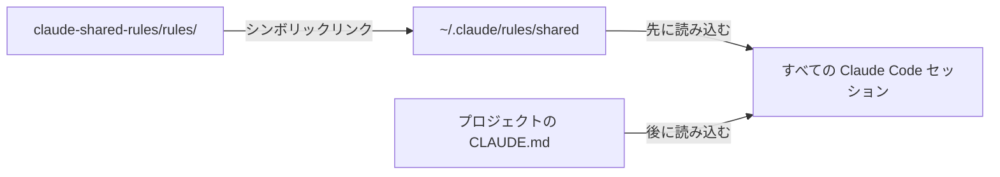

<!-- source: docs/en/SETUP.md blob 8e368c77c4b70b958dbc92cfd32cd0c783222a37 -->
[English](../en/SETUP.md) | 日本語 · [目次に戻る](README.md)

> この文書は[英語版](../en/SETUP.md)の翻訳。内容が異なる場合は英語版が優先する。

# セットアップ

シンボリックリンクを 1 本張るだけで、このマシンのすべての Claude Code セッションで共有ルールが有効になる。この文書ではインストール、確認、更新、削除の手順を説明する。



## インストール

必要なもの：`git` が使える macOS か Linux（[Windows](#windows未検証) は未検証）、Claude Code 2.1.281 以上（[理由](#バージョン要件)）、GitHub 上のこのリポジトリへのアクセス権。

1. リポジトリをクローンする：

   ```bash
   git clone https://github.com/musica-sanare/claude-shared-rules.git ~/repos/claude-shared-rules
   ```

2. リンクを作る場所に何もないことを確かめる。`No such file or directory` と出れば正常：

   ```bash
   ls -la ~/.claude/rules/shared
   ```

3. リンクを作る：

   ```bash
   mkdir -p ~/.claude/rules
   ```

   ```bash
   ln -s ~/repos/claude-shared-rules/rules ~/.claude/rules/shared
   ```

共有しない個人用ルールは、`~/.claude/rules/` に別ファイルとして直接置けばよい。

## 確認

1. 任意のプロジェクトで**新しい**セッションを開く。実行中のセッションは、追加・変更したルールを読み込まない。
2. `/context` を実行する。**Memory files** に `rules/` の全ファイルが出ていれば成功：
   `overrides.md`、`language.md`、`documentation.md`、`writing-style.md`、`git.md`、`public-repo-safety.md`、`github-workflow.md`。
3. 任意：読み込んだ共有ルールを Claude に尋ねる。日本語で答えれば正常。

ファイルが出ない場合は、`ls -la ~/.claude/rules/` でリンクとリンク先を確かめる。

## 更新

```bash
git -C ~/repos/claude-shared-rules pull
```

新しいセッションから更新後のルールが効く。実行中のセッションは再起動すれば反映される。

## アンインストール

リンクを削除する。末尾にスラッシュを付けなければ、リンクだけが消えてリポジトリは残る：

```bash
rm ~/.claude/rules/shared
```

[推奨設定](#推奨設定)を入れていた場合は、それも外す。クローンは残しても消してもよい。

## 推奨設定

ルールは Claude への指針で、強制力はない。次の設定で 2 つのルールを強制できる：AI 帰属表示を付けないことと、push の前に必ず確認すること。`~/.claude/settings.json` に統合し、ファイルごと置き換えないこと。

> [!WARNING]
> 2.1.281 より前の Claude Code は `"attribution": false` を受け付けず、設定ファイル全体を読み飛ばす。古いバージョンでは代わりに `{ "attribution": { "commit": "", "pr": "", "sessionUrl": false } }` を使う。

```json
{
  "attribution": false,
  "permissions": {
    "ask": ["Bash(git push *)"]
  }
}
```

- `"attribution": false`：Claude Code が既定で付けるコミットのトレーラーと PR の帰属表示を消す。
- `Bash(git push *)`：`git push` で始まるコマンドの前に、auto モードでも確認が入る。`git -C . push` のような別の書き方は拾えないので、あくまで安全網と考える。

## 新しいマシン

1. Git と Claude Code を入れ、GitHub にサインインする。
2. [インストール](#インストール)の手順を実行する。
3. 必要なら[推奨設定](#推奨設定)を入れる。
4. 各プロジェクトをクローンし、どれか一つで[確認](#確認)する。

## Windows（未検証）

> [!WARNING]
> この節の内容は Windows で一度も試していない。使う前に各項目を確かめ、結果をここに記録すること。

WSL は Linux と同じで、WSL の中で本文の手順を実行すればよい。ネイティブの Windows でも設計は変わらず、違うのはリンクとシェルだけだ。

- **リンク**：シンボリックリンクの代わりにディレクトリのジャンクションを使う。ジャンクションなら管理者権限も開発者モードも要らない。PowerShell で：

  ```powershell
  git clone https://github.com/musica-sanare/claude-shared-rules.git $HOME\repos\claude-shared-rules
  ```

  ```powershell
  Test-Path $HOME\.claude\rules\shared
  ```

  `False` と出れば正常。続けて：

  ```powershell
  New-Item -ItemType Directory -Force $HOME\.claude\rules
  ```

  ```powershell
  New-Item -ItemType Junction -Path $HOME\.claude\rules\shared -Target $HOME\repos\claude-shared-rules\rules
  ```

- **アンインストール**：`rmdir` ならジャンクションだけが消え、リンク先のファイルは残る：

  ```powershell
  cmd /c rmdir "$HOME\.claude\rules\shared"
  ```

- **チェック用スクリプト**：[共有ルールの導入](ADOPTING.md#チェック)のスクリプトは bash が必要。Git Bash か WSL で実行する。

未解決の点（`要確認`）：

- Claude Code は `~/.claude/rules/` 以下のジャンクションをたどってルールを読み込むか。`/context` で確かめる。
- `**/claude-shared-rules/rules/documentation.md` のような `claudeMdExcludes` のパターンが、Windows のパス（`\` 区切りやドライブ名）に一致するか。

## 既知の制約

- **クラウドセッション**（Claude Code on the web などリモートで動くセッション）は、この Mac の `~/.claude/` を見られない。そこでも効かせたいルールはプロジェクトの `CLAUDE.md` に書く。
- **Cowork セッション**は、作業ディレクトリの外を指すシンボリックリンクのルールを読み飛ばすので、共有ルールが効かない。CLI とデスクトップの Code タブには影響しない。
- **競合**：ユーザールールとプロジェクトルールがぶつかっても、Claude Code 自体はどちらも優先しない。[上書きとオプトアウト](OVERRIDES.md)の優先順位は、ルールに明記してあるから機能する。
- **Windows** の手順は未検証。[Windows（未検証）](#windows未検証)を参照。

## 背景

### 読み込みの仕組み

Claude Code は、どのプロジェクトでも `~/.claude/rules/` 以下の `.md` ファイルをすべて、プロジェクト自身の指示より先に読み込む。サブディレクトリも探し、シンボリックリンクもたどる。ユーザースコープのルールには承認ダイアログが出ない。

### バージョン要件

| バージョン | 必要になる機能 |
|---|---|
| 2.1.281 以上 | [推奨設定](#推奨設定)の `"attribution": false` |
| 2.1.239 以上 | シンボリックリンク経由のルールを、`claudeMdExcludes` でリンク側のパスで指定すること |

### 出典

2026-10-25 に Claude Code の公式ドキュメントで確認した：[Memory](https://code.claude.com/docs/en/memory)、[Settings reference](https://code.claude.com/docs/en/settings-reference)、[Permissions](https://code.claude.com/docs/en/permissions)。記述どおりに動かないときは再確認する。
